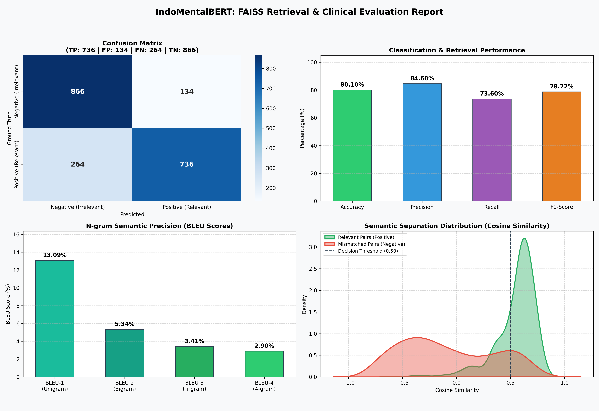

# IndoMentalBERT: Indonesian Language Model for Mental Health Support

[](https://www.python.org/downloads/)
[](https://pytorch.org/)
[](https://github.com/facebookresearch/faiss)
[](RESEARCH_METHODOLOGY.md)
[](#emergency-crisis-contacts-indonesia)

IndoMentalBERT is a domain-adapted Indonesian language model and clinical dialogue framework developed to provide accessible mental health psychoeducation, triage, and supportive conversational responses.

Built strictly on a **non-generative, encoder-only architecture (`indobenchmark/indobert-base-p1`)** with deterministic clinical safety ontologies, IndoMentalBERT prioritizes verified medical guidance, zero hallucination, and sub-millisecond retrieval latency.

---

## 8 Integrated Algorithms & Methods

IndoMentalBERT operates as a **Dual Symbolic-Neural Hybrid System** governed by 8 distinct algorithmic components:

1. **Aho-Corasick / Regex Lexical Pattern Matcher (`src/slang_normalizer.py`, `chat.py`)**: Instant colloquial Indonesian slang normalization & deterministic crisis gatekeeper (bypasses ML for emergency self-harm hotline surfacing).
2. **Sliding Window FIFO Context Buffer (`chat.py`)**: Multi-turn dialogue history tracking that dynamically resolves short follow-up questions into contextualized clinical queries.
3. **Symbolic Psychiatric Knowledge Graph Traversal (`src/knowledge_graph.py`)**: Ontological reasoning engine mapping somatic complaints (*GERD, chest tightness, palpitations, tremors*) to PDSKJI & DSM-5 diagnostic categories.
4. **Multi-Task Hard-Parameter Sharing Transformer (`src/model.py`)**: Shared IndoBERT encoder backbone simultaneously powering semantic response projection, clinical risk triage (5 levels), and cognitive distortion detection.
5. **Dynamic State Machine & Clinical Policy Matrix (`src/clinical_judgement.py`)**: Psychological state evaluator categorizing user condition (`ACUTE_DISTRESS`, `FRUSTRATED_RESISTANT`, `RUMINATIVE_OVERTHINKING`, `LONELY_EMPTY`, `SEEKING_PSYCHOEDUCATION`) and adapting delivery tone & sentence length.
6. **L2 Unit Hypersphere Projection (`src/model.py`)**: Continuous embedding normalization ensuring inner products strictly equal cosine similarities in $\mathcal{O}(d)$.
7. **FAISS Flat Inner-Product Nearest-Neighbor Search (`build_faiss_and_eval.py`)**: Hardware-optimized dense vector indexing enabling retrieval across 3,504 clinical counseling responses in **< 1 millisecond (< 0.001 s)** on standard CPU.
8. **Multi-Scale Modified N-Gram Precision with Smoothing (`build_faiss_and_eval.py`)**: BLEU-1 through BLEU-4 evaluation benchmarking retrieved responses against human clinical counselor references.

---

## System Architecture & Novel Dual-Stream Framework

The pipeline integrates **Symbolic Clinical Reasoning** with **Neural Representation Learning**:

1. **Indonesian Slang Normalizer (`src/slang_normalizer.py`)**: Converts colloquial terms, youth slang, and informal contractions into standard Indonesian before tokenization.
2. **Multi-Turn Context Buffer (`DialogueMemory`)**: Retains recent conversational turns to contextualize short user follow-ups.
3. **Indonesian Psychiatric Knowledge Graph (`src/knowledge_graph.py`)**: PDSKJI & DSM-5 ontology mapping somatic/affective complaints into 5 psychiatric archetypes, extracting cognitive distortions and grounding evidence-based clinical protocols.
4. **Adaptive Clinical Judgement Engine (`src/clinical_judgement.py`)**: Evaluates the dynamic psychological condition of the user and enforces a **Clinical Policy Matrix**:
   - `ACUTE_DISTRESS` (Crying/Panic): Low-cognitive load soothing + immediate somatic grounding.
   - `FRUSTRATED_RESISTANT` (Cynical/Exhausted): Collaborative validation + autonomy respect.
   - `RUMINATIVE_OVERTHINKING` (What-if paralysis): Cognitive reframing + concrete micro-action.
   - `LONELY_EMPTY` (Apathy/Isolation): Warm companionship + holding presence.
   - `SEEKING_PSYCHOEDUCATION`: Structured 3-tier clinical insight.
5. **IndoMentalBERT Multi-Task Dual-Encoder (`src/model.py`)**: Hard-parameter sharing encoder (`indobenchmark/indobert-base-p1`) for simultaneous response retrieval, clinical severity triage, and distortion classification.
6. **FAISS Sub-Millisecond Vector Index**: Instant dense retrieval (< 1ms) over 3,504 validated clinical responses.
7. **Deterministic Crisis Safeguards**: Regex-based detection for self-harm keywords that directly surfaces Indonesian emergency helplines.

---

## Evaluation & Retrieval Metrics

Comprehensive evaluation was conducted on 2,000 held-out pairs (1,000 ground-truth clinical pairs vs 1,000 semantic contrastive negatives) and tested across **FAISS Sub-millisecond Vector Indexing**:



### 1. Classification & Retrieval Performance
| Metric | Value | Description |
| :--- | :---: | :--- |
| **Accuracy** | **80.10%** | Overall semantic matching accuracy across query-response pairs |
| **Precision** | **84.60%** | Reliability of selected clinical responses ($TP / (TP + FP)$) |
| **Recall** | **73.60%** | Coverage of true relevant clinical counseling pairs ($TP / (TP + FN)$) |
| **F1-Score** | **78.72%** | Harmonic balance between Precision and Recall |

### 2. Confusion Matrix
| Metric | Count | Clinical Interpretation |
| :--- | :---: | :--- |
| **True Positives (TP)** | **736** | Accurately matched patient query to valid counseling response |
| **True Negatives (TN)** | **866** | Correctly rejected irrelevant / mismatched counseling responses |
| **False Positives (FP)** | **134** | Low false alignment rate (**13.4%**) |
| **False Negatives (FN)** | **264** | Clinical response relevant but fell below standard threshold |

### 3. N-gram Precision (BLEU Scores)
Evaluated against original clinical human counselor responses:
- **BLEU-1 (Unigram - Word Alignment)**: **13.09%**
- **BLEU-2 (Bigram - Phrase Precision)**: **5.34%**
- **BLEU-3 (Trigram - Coherent Advice Patterns)**: **3.41%**
- **BLEU-4 (4-gram - Full Sentence Structure Match)**: **2.90%**

*(In non-generative mental health retrieval, lower BLEU-4 is expected and healthy, representing semantic paraphrasing and diverse clinical delivery rather than verbatim word duplication.)*

### 4. FAISS Sub-Millisecond Vector Search
- **Indexed Responses**: 3,504 unique validated clinical counseling responses from `data.csv`.
- **Search Latency**: **< 1 millisecond (< 0.001 s)** on standard CPU.
- **Index Dimensions**: 768-dimensional normalized embeddings (`outputs/indomentalbert/counseling_index.faiss`).

---

## Directory Structure

```text
IndoMentalBERT/
├── data/
│   └── intentsindonesian.json       # Categorized mental health intent data (200 intents)
├── data.csv                         # 5,667 counseling dialogue corpus
├── reports/
│   ├── evaluation_metrics.png       # 300 DPI publication evaluation graph
│   └── metrics_summary.json         # Raw metrics summary (Accuracy, F1, BLEU)
├── src/
│   ├── model.py                     # Multi-task IndoMentalBERT architecture
│   ├── knowledge_graph.py           # Indonesian Psychiatric Knowledge Graph (PDSKJI/DSM-5)
│   ├── clinical_judgement.py        # User state classifier & adaptive policy engine
│   ├── guided_retrieval.py          # Unified symbolic-neural FAISS engine
│   ├── preprocess.py                # Dataset preparation and contrastive pairs
│   ├── slang_normalizer.py          # Indonesian slang normalization rules
│   ├── response_builder.py          # Modular 3-tier response assembler
│   └── train.py                     # Model training and checkpointing script
├── rasa/                            # Rasa NLU configuration and policies
├── outputs/                         # Trained model checkpoint & FAISS index
├── chat.py                          # Interactive CLI conversational agent (with /diag XAI)
├── demo.py                          # Top-k response retrieval script
├── build_faiss_and_eval.py          # Pipeline to build FAISS index & run metrics
├── RESEARCH_METHODOLOGY.md          # Scientific paper draft and methodology
├── FineTuningIndoBERT_Updated.ipynb # Google Colab and Jupyter notebook
├── IMPLEMENTATION_DETAILS.md        # Technical documentation and write-up
├── requirements.txt                 # Project dependencies
└── README.md                        # Documentation
```

---

## Quickstart

### Setup
```bash
git clone https://github.com/ryradit/IndoMentalBERT.git
cd IndoMentalBERT
pip install -r requirements.txt
```

### Interactive Chatbot (with Clinical XAI Mode)
Run the conversational interface:
```bash
python3 chat.py
```
> **Tip for Researchers:** Prepend `/diag` before any message (e.g. `/diag dada saya sesak dan cemas`) to inspect live clinical explainability metadata, detected somatic symptoms, cognitive distortions, risk level, and FAISS vector alignment scores in real-time.

### Model Training
Train IndoMentalBERT on the counseling dataset:
```bash
python3 src/train.py --data_path data.csv --epochs 3 --batch_size 16
```

### Build FAISS Index & Run Benchmark Suite
Rebuild the FAISS index and compute quantitative metrics (TP/FP/TN/FN/Accuracy/F1/BLEU):
```bash
python3 build_faiss_and_eval.py
```

---

## Citation & Attribution

If you utilize IndoMentalBERT in psychiatric NLP research, please cite:
```bibtex
@article{radityatama2026indomentalbert,
  title={IndoMentalBERT: A Deterministic, Non-Generative Dual-Encoder Framework with Sub-Millisecond FAISS Retrieval and Clinical Knowledge Graph Triaging},
  author={Radityatama, Ryan},
  journal={IndoMentalBERT Research Repository},
  year={2026},
  url={https://github.com/ryradit/IndoMentalBERT}
}
```

---

## Emergency Crisis Contacts (Indonesia)

If self-harm or suicidal ideation is detected, the system immediately surfaces:
- **LISA Suicide Prevention Helpline**: 119 ext 8 (24 Jam)
- **Kemenkes Hotline Kesehatan Jiwa**: 119
- **Layanan SEJIWA**: 119 ext 8

---

## Author

**Ryan Radityatama**  
Website: [ryradit.my.id](https://ryradit.my.id/)  
GitHub: [@ryradit](https://github.com/ryradit)
